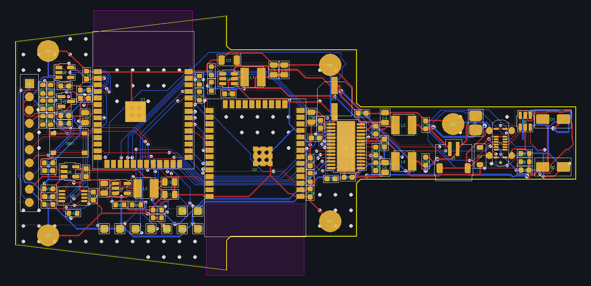

# Google Home Revive

Deux cartes électroniques de remplacement pour le **Google Home de 1re génération (2016)**, pour le transformer en
assistant vocal local et ouvert sous **Home Assistant** (ESPHome). Le boîtier, le haut-parleur et l'anneau lumineux
d'origine sont conservés ; l'électronique Google est remplacée.

- Carte mère : même forme et mêmes trous de fixation que l'originale, USB-C, ampli classe D, coupure micro matérielle.
- Carte du dessus : 2 micros numériques, anneau de 12 LED, anneau tactile capacitif.
- Liaison entre les deux cartes : 10 fils soudés.
- Fabrication et assemblage complets par JLCPCB : rien à souder sur les cartes, seulement les fils de liaison.

## Aperçu des cartes

| | Face composants | Face arrière |
|---|---|---|
| Carte mère (107,6 x 49 mm, 2 couches) |  |  |
| Carte du dessus (diamètre 74,8 mm, 2 couches) |  |  |

Les deux cartes passent le contrôle DRC de KiCad sans erreur ni connexion manquante (rapports :
`hardware/*/gh_*_drc.json`).

## Fonctions

| Fonction | Réalisation |
|---|---|
| Processeur principal | ESP32-S3-WROOM-1-N16R8 (Wi-Fi, 16 Mo de flash, 8 Mo de PSRAM) |
| Mot d'activation | « Hey Jarvis » détecté sur l'appareil (micro_wake_word), pipeline vocal Home Assistant |
| Micros | 2 x Infineon IM69D130 (SNR 69 dB(A), AOP 130 dB SPL), meilleurs que les InvenSense INMP621 d'origine (65 dB(A)) |
| Annulation d'écho | référence I2S renvoyée par l'ampli (SDOUT du TAS5805M) vers l'S3 |
| Ampli | TI TAS5805M (I2S, DSP intégré, pont BTL) |
| Bluetooth | ESP32-WROOM-32E dédié en récepteur A2DP, flashé à travers l'S3 |
| Tactile | MPR121, 10 secteurs : rotation horaire = volume +, antihoraire = volume -, tap = pause / lecture, double tap = piste suivante |
| LED | 12 WS2812B-2020 sous le diffuseur d'origine |
| Coupure micro | interrupteur matériel : l'horloge des micros est coupée physiquement, l'état est lu par l'S3 |
| Alimentation / service | USB-C vertical |

Cahier des charges complet : [docs/cahier_des_charges.md](docs/cahier_des_charges.md).

## Coût moyen

Prix relevés le 14/11/2026 (devis en ligne JLCPCB, stock JLC), taux 1 $ = 0,86 EUR, livraison en France, taxes comprises.

### Cartes assemblées par JLCPCB (solution retenue)

JLC assemble au minimum 2 exemplaires de chaque carte : la commande donne 2 appareils complets.

| Poste | USD | EUR |
|---|---:|---:|
| Carte mère assemblée x 2 (composants compris) | 99,85 | 85,87 |
| Carte du dessus assemblée x 2, double face (composants compris) | 112,14 | 96,44 |
| PCB nus (5 de chaque, 2 couches) | 10,60 | 9,12 |
| Coupon SMT mensuel JLC | -9,00 | -7,74 |
| Livraison DHL Express | 24,00 | 20,64 |
| TVA 20 % et frais de dédouanement | 61,47 | 52,87 |
| **Total pour 2 appareils** | **~299 $** | **~257 EUR** |
| **Coût moyen par appareil** | **~150 $** | **~129 EUR** |

Détail ligne par ligne : [docs/devis_assemble.md](docs/devis_assemble.md).

### Variante en kit, soudure maison (1 appareil)

PCB nus JLCPCB + composants LCSC + micros achetés à l'unité : **~83 $ / ~71 EUR TTC**
([docs/devis.md](docs/devis.md)). Demande une station à air chaud ou une plaque chauffante (micros LGA,
MPR121 en QFN 0,4 mm, pad thermique de l'ampli).

## Contenu du dépôt

```
hardware/
  mainboard/            carte mère : projet KiCad 10, aperçus, rapport DRC
    fab/                fichiers JLCPCB : gerbers.zip, bom.csv, cpl.csv
  topboard/             carte du dessus : idem
  lib/gh_revive.pretty  empreintes spécifiques (micros, électrodes, pastilles de liaison)
firmware/
  s3/                   ESPHome pour l'ESP32-S3 (voix, média, tactile, LED, ampli, mute)
  bt/                   PlatformIO : récepteur Bluetooth A2DP + pont de flashage USB
  homeassistant/        automatisation des gestes (double tap = piste suivante)
  tests/                test unitaire du décodeur de gestes
docs/                   cahier des charges, devis
tools/                  génération des cartes (KiCad Python + FreeRouting) et calcul des devis
```

## Commander chez JLCPCB

Pour chaque carte (`mainboard` puis `topboard`) :

1. Téléverser `hardware/<carte>/fab/gh_<carte>_gerbers.zip` sur jlcpcb.com.
2. Options : 2 couches, 1,6 mm, HASL sans plomb, vias « Tented », quantité 5.
3. Activer « PCB Assembly », quantité 2 :
   - carte mère : **Economic**, face du dessus ;
   - carte du dessus : **Standard**, **les deux faces** (les LED sont sur la face arrière).
4. Téléverser `gh_<carte>_bom.csv` et `gh_<carte>_cpl.csv`, vérifier que toutes les pièces sont trouvées en stock.
5. À l'étape de vérification des placements, contrôler l'orientation des micros, des LED et de l'ampli.

Avant de commander, vérifier la mécanique (section 8 du cahier des charges) sur l'appareil réel.

## Firmware

### ESP32-S3 (ESPHome)

```bash
pip install esphome
cd firmware/s3
cp secrets.example.yaml secrets.yaml      # renseigner Wi-Fi, mots de passe et clé API
esphome run gh-revive.yaml                # premier flash par USB-C, ensuite par OTA
```

Sans réseau Wi-Fi connu, l'appareil ouvre le point d'accès « GH-Revive Setup » avec un portail de configuration.

### Module Bluetooth (PlatformIO)

Le module Bluetooth n'a pas de port USB : l'S3 sert de pont le temps de le programmer.

```bash
cd firmware/bt
pio run -e bridge -t upload                   # l'S3 devient un pont USB <-> UART vers le module
pio run -e bt -t upload --upload-port COMx    # programme le module Bluetooth
esphome run ../s3/gh-revive.yaml              # remet le firmware principal sur l'S3
```

### Test du décodeur de gestes

```bash
g++ -std=c++17 -Wall -Wextra -Werror -I firmware/s3 firmware/tests/test_ring_gesture.cpp -o test_ring && ./test_ring
```

### État du firmware

C'est une base de départ. Fonctionnel dans la configuration : Wi-Fi + portail de secours, OTA, mot d'activation et
assistant vocal, lecteur multimédia avec atténuation pendant la voix, démarrage de l'ampli, anneau tactile, LED, mute,
pilotage du module Bluetooth. Reste à développer : l'annulation d'écho avec ESP-SR (composant ESP-IDF dédié) et le relais
du flux Bluetooth vers l'ampli (l'S3 n'a que deux périphériques I2S, voir la section 10 du cahier des charges).

## Régénérer les cartes

Les cartes sont décrites en Python (`tools/ghrevive/`) et générées avec KiCad 10 et FreeRouting :

```bash
"C:/Program Files/KiCad/10.0/bin/python.exe" tools/build.py all              # placement, routage, DRC, fichiers JLC
"C:/Program Files/KiCad/10.0/bin/python.exe" tools/quote_assembled.py        # devis assemblé
"C:/Program Files/KiCad/10.0/bin/python.exe" tools/quote.py                  # devis kit
```

## Licence

MIT, voir [LICENSE](LICENSE). Projet indépendant, sans lien avec Google. « Google Home » est une marque de Google LLC.
