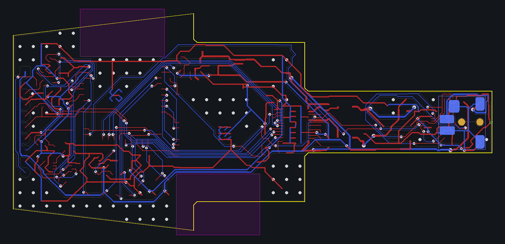
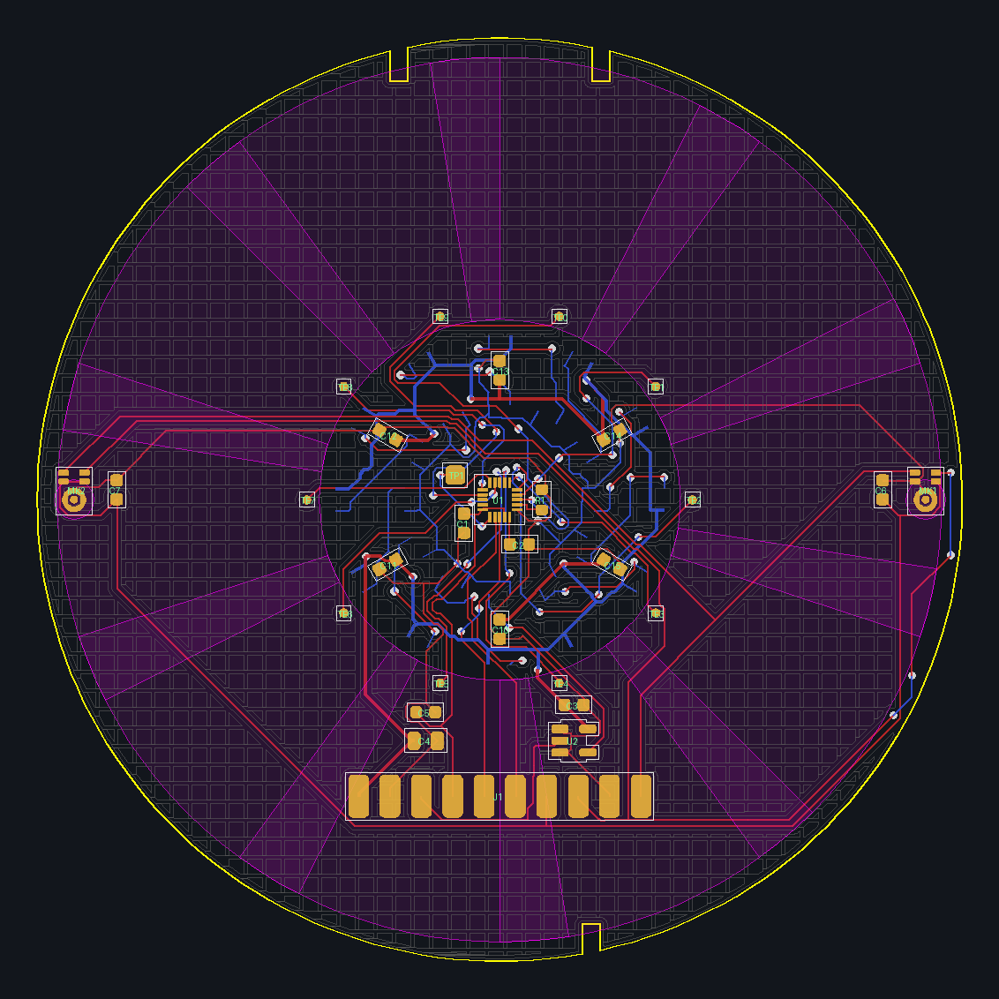
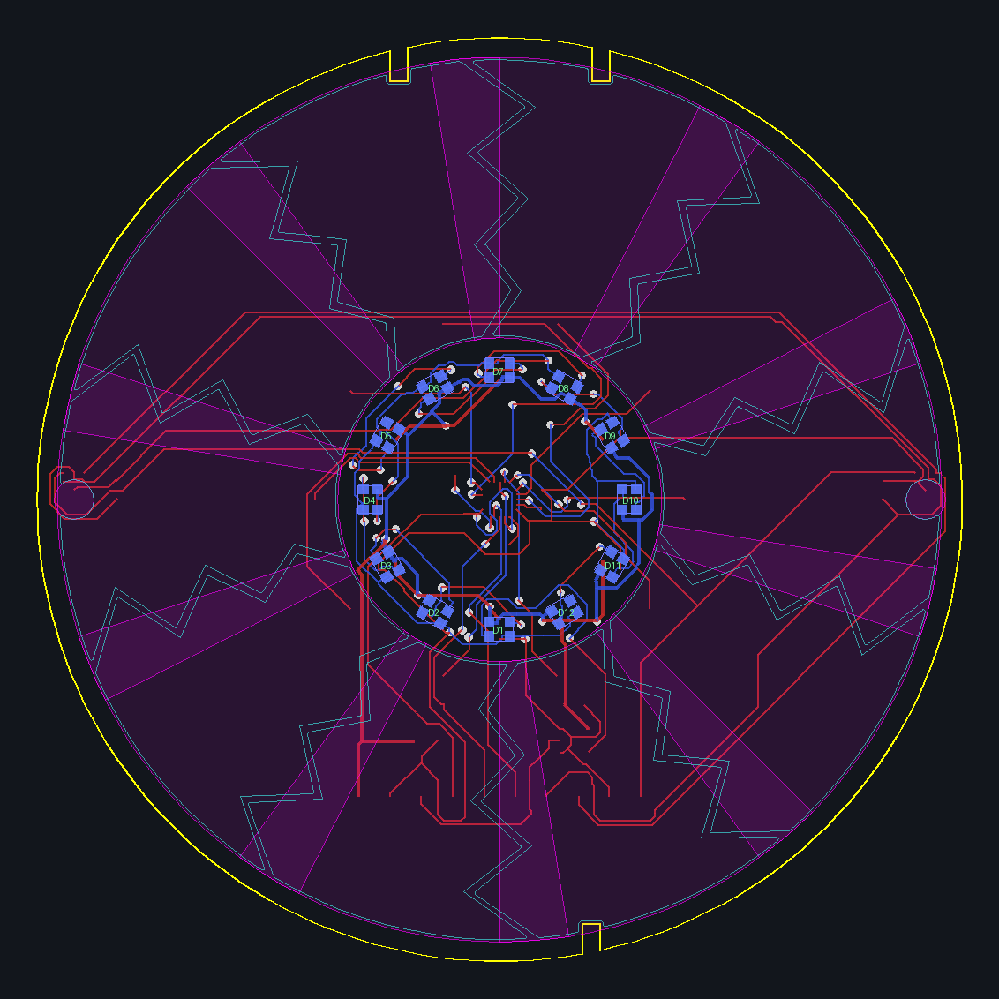
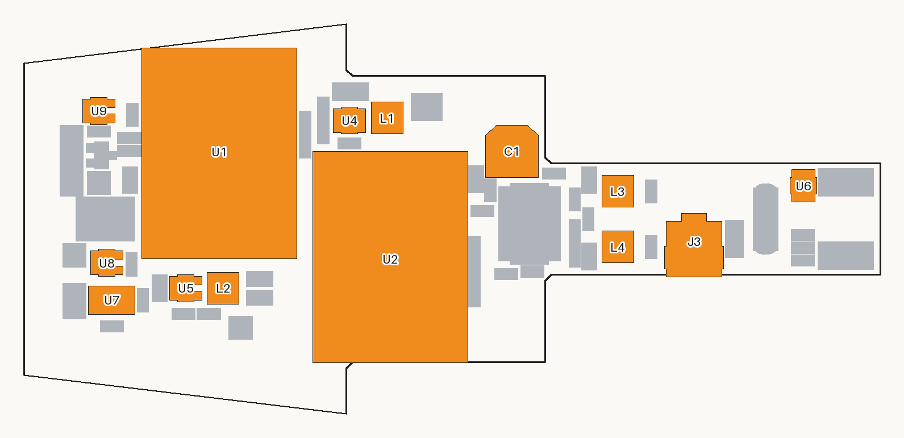
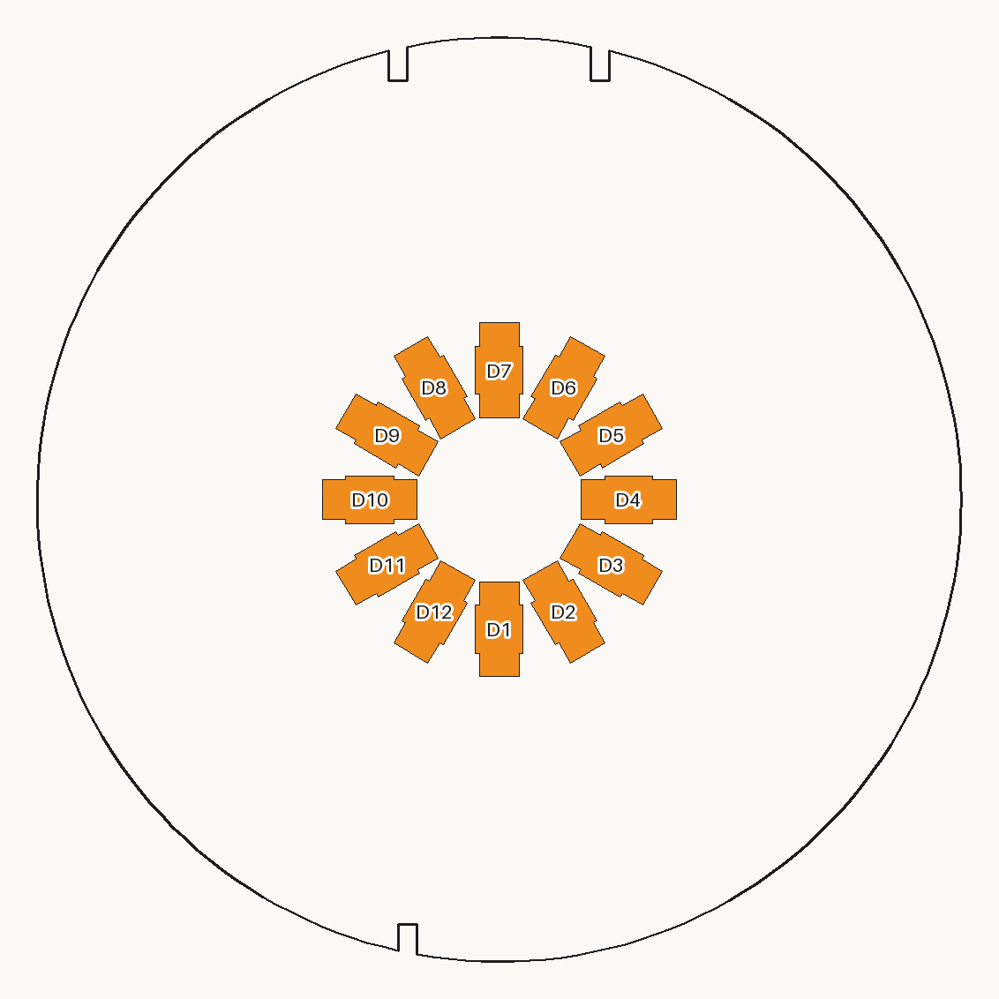
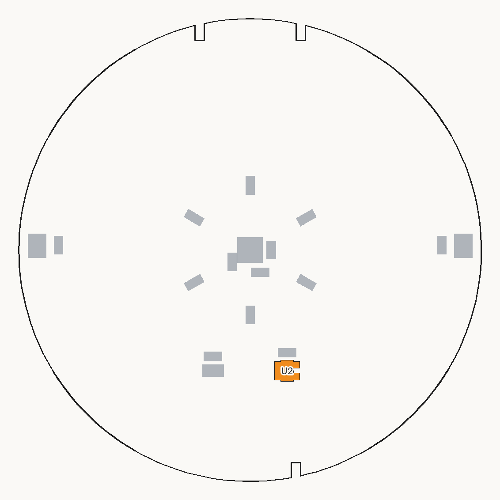

# Google Home Revive

Deux cartes électroniques de remplacement pour le **Google Home de 1re génération (2016)**, pour le transformer en
assistant vocal local et ouvert sous **Home Assistant** (ESPHome). Le boîtier, le haut-parleur et l'anneau lumineux
d'origine sont conservés ; l'électronique Google est remplacée.

- Carte mère : même forme et mêmes trous de fixation que l'originale, USB-C, ampli classe D, coupure micro matérielle.
- Carte du dessus : 2 micros numériques, anneau de 12 LED RGB, anneau tactile capacitif et touche centrale.
- Liaison entre les deux cartes : 10 fils soudés (des câbles Dupont coupés suffisent).
- **Les pièces délicates sont soudées en usine par JLCPCB** (micros, contrôleur tactile, ampli, USB-C, tous les petits
  passifs). Il reste à souder au fer des pièces à pattes visibles, listées plus bas avec leur emplacement.

## Aperçu des cartes

| | Face composants | Face arrière |
|---|---|---|
| Carte mère (107,6 x 49 mm, 2 couches) |  |  |
| Carte du dessus (diamètre 74,8 mm, 2 couches) |  |  |

Les deux cartes passent le contrôle DRC de KiCad sans erreur ni connexion manquante (rapports :
`hardware/*/gh_*_drc.json`).

## Fonctions

| Fonction | Réalisation |
|---|---|
| Processeur principal | ESP32-S3-WROOM-1-N16R8 (Wi-Fi, 16 Mo de flash, 8 Mo de PSRAM) |
| Mot d'activation | « Hey Jarvis » détecté sur l'appareil (micro_wake_word), pipeline vocal Home Assistant |
| Micros | 2 x Infineon IM69D130 (SNR 69 dB(A), AOP 130 dB SPL), meilleurs que les InvenSense INMP621 d'origine (65 dB(A)) |
| Annulation d'écho | référence I2S renvoyée par l'ampli (SDOUT du TAS5805M) vers l'S3 |
| Ampli | TI TAS5805M (I2S, DSP intégré, pont BTL) |
| Bluetooth | ESP32-WROOM-32E dédié en récepteur A2DP, flashé à travers l'S3 |
| Tactile | MPR121 : anneau de 10 secteurs (rotation horaire = volume +, antihoraire = volume -) et touche ronde au centre ; appui bref n'importe où = pause / lecture, double appui = piste suivante |
| LED | 12 LED RGB adressables WS2812B-MINI-V3J (couleur 24 bits réglable LED par LED) sous le diffuseur d'origine : animations arc-en-ciel, comète, scintillement, etc., pilotables depuis Home Assistant |
| Coupure micro | interrupteur matériel : l'horloge des micros est coupée physiquement, l'état est lu par l'S3 |
| Alimentation / service | USB-C vertical (flash, journaux) |
| Configuration Wi-Fi | point d'accès + page de configuration, l'adresse IP est annoncée à voix haute |

Cahier des charges complet : [docs/cahier_des_charges.md](docs/cahier_des_charges.md).

## Coût

Prix relevés le 14/11/2026 (devis JLCPCB, stock JLC et LCSC), taux 1 $ = 0,86 EUR, livraison en France, TVA 20 % et
taxe petits colis comprises. Une seule commande JLCPCB + LCSC, sous le seuil de 150 EUR (pas de frais de dédouanement).

| Commande | USD TTC | EUR TTC |
|---|---:|---:|
| **1 appareil** (+ 1 jeu de cartes pré-assemblées en réserve) | **129,13** | **111,06** |
| **2 appareils** dans la même commande | **142,27** | **122,35** |
| **Coût moyen par appareil, commande de 2** | **71,13** | **61,17** |

JLCPCB assemble au minimum **2 exemplaires** de chaque carte et fabrique au minimum **5 PCB**. Le 2e jeu assemblé coûte
environ 20 $ (20 EUR TTC) de plus que le 1er ; les 3 PCB nus restants sont compris dans le prix minimum de 5. Le plus
rentable est donc d'en faire deux (ou de partager la commande). Avec l'application de bureau JLCPCB, les PCB sont
4 $ moins chers : 106,93 EUR pour 1 appareil, 59,11 EUR par appareil pour 2.

Détail ligne par ligne : [docs/devis_partiel.md](docs/devis_partiel.md). Autres scénarios : tout assemblé par JLCPCB
(~129 EUR par appareil, [docs/devis_assemble.md](docs/devis_assemble.md)), ou kit entièrement soudé à l'air chaud
(~71 EUR, [docs/devis.md](docs/devis.md)).

## Commander

Chaque carte a trois fichiers dans `hardware/<carte>/fab/` :

| Fichier | Où l'envoyer | Contenu |
|---|---|---|
| `gh_<carte>_gerbers.zip` | JLCPCB | le circuit imprimé |
| `gh_<carte>_bom.csv` + `gh_<carte>_cpl.csv` | JLCPCB (assemblage) | pièces soudées en usine et leur position |
| `gh_<carte>_hand_bom.csv` | LCSC (pas JLCPCB) | pièces à souder soi-même |

### 1. JLCPCB : PCB + assemblage des pièces délicates

À faire deux fois, d'abord pour `mainboard`, puis pour `topboard` :

1. Sur jlcpcb.com, « Order now », puis « Add gerber file » : choisir `gh_<carte>_gerbers.zip`.
2. Options du PCB : 2 couches, épaisseur 1,6 mm, finition **HASL sans plomb** (« LeadFree HASL », exigée pour
   l'assemblage), vias « Tented », quantité 5.
3. En bas de la page, activer **« PCB Assembly »** :
   - type **Economic** ;
   - face assemblée **Top** ;
   - quantité assemblée **2** (minimum imposé) ;
   - valider.
4. Page suivante : « Add BOM File » = `gh_<carte>_bom.csv`, « Add CPL File » = `gh_<carte>_cpl.csv`, puis
   « Process BOM & CPL ».
5. Liste des pièces : toutes doivent être trouvées et cochées. Si une pièce est en rupture, choisir un équivalent de
   même valeur et même boîtier. Ne pas téléverser `gh_<carte>_hand_bom.csv` ici.
6. Vérification des placements : la vue montre chaque pièce sur la carte. Contrôler l'orientation du TAS5805M (U3),
   du transistor Q1 et de l'USB-C (J1) pour la carte mère, des micros (MK1, MK2) et du MPR121 (U1) pour la carte du
   dessus : les pattes doivent tomber sur les pastilles et le point rose (broche 1) sur le repère triangulaire de la
   sérigraphie. Une pièce tournée ou décalée se corrige dans cette vue : la sélectionner, puis boutons de rotation ou
   flèches du clavier. Les ingénieurs JLCPCB revérifient aussi les placements avant la production.
   Seules les pièces de `gh_<carte>_bom.csv` apparaissent : les modules ESP32, bobines, C1, etc. sont absents, c'est
   normal (à souder soi-même).
7. « Save to cart ».

Les deux cartes se paient ensemble dans le panier. Appliquer le coupon SMT mensuel (9 $) s'il est proposé.

### 2. LCSC : pièces à souder soi-même

1. Sur lcsc.com, ouvrir l'outil « BOM Tool » et téléverser `hardware/mainboard/fab/gh_mainboard_hand_bom.csv`, puis
   `hardware/topboard/fab/gh_topboard_hand_bom.csv` (colonne « LCSC Part # »).
2. Pour 2 appareils, doubler les quantités. LCSC impose parfois un minimum (5 ou 10 pièces pour les petits circuits) :
   accepter, le surplus coûte quelques centimes.
3. Au paiement, regrouper l'envoi avec la commande JLCPCB (option de colis combiné) pour payer une seule livraison.
4. Ajouter un paquet de **câbles Dupont femelle-femelle de 20 cm** (n'importe quel vendeur) si vous n'en avez pas.

Avant de commander, vérifier la mécanique (section 8 du cahier des charges) sur l'appareil réel.

## Ce qu'il faut souder soi-même

<p align="center">
  <a href="docs/manuel_soudure.md">
    
  </a>
</p>

Le [manuel de soudure](docs/manuel_soudure.md) reprend tout pas à pas : liste des composants face par face, plans,
technique pour chaque type de pièce, fils de liaison et contrôles avant la mise sous tension. Résumé ci-dessous.

Les cartes arrivent avec les pièces délicates déjà soudées. Restent uniquement des pièces dont les pattes sont visibles
et accessibles à la panne du fer. Sur les plans, **en orange : à souder soi-même**, en gris : déjà soudé par JLCPCB.

Outillage : fer à panne fine (biseau 1 à 2 mm), étain 0,5 mm, flux, tresse à dessouder, pince brucelles, loupe.
Pas d'air chaud nécessaire. Ordre conseillé : petits circuits d'abord, puis bobines, condensateur, modules, connecteur.

### Carte mère (face composants)



| Repère | Pièce | Lien LCSC | Qté | Boîtier | Variantes et pièges |
|---|---|---|---:|---|---|
| U1 | ESP32-S3-WROOM-1-N16R8 | [C2913202](https://www.lcsc.com/product-detail/C2913202.html) | 1 | module 18 x 25,5 mm, pattes crénelées | N8R8 ou N16R2 conviennent (PSRAM obligatoire). Éviter WROOM-1U (antenne externe), WROOM-2 et MINI (brochage différent). |
| U2 | ESP32-WROOM-32E-N4 | [C701341](https://www.lcsc.com/product-detail/C701341.html) | 1 | module 18 x 25,5 mm | N8 / N16 conviennent. Éviter WROOM-32UE (antenne externe) et WROVER. |
| U4 | TPS54302DDCR | [C311983](https://www.lcsc.com/product-detail/C311983.html) | 1 | SOT-23-6 (« DDC ») | Régulateur 5 V. Pas de TPS54202 (autre brochage). |
| U5 | TLV62569DBVR | [C141836](https://www.lcsc.com/product-detail/C141836.html) | 1 | SOT-23-5 (« DBV ») | Régulateur 3,3 V. Pas la version DRL (boîtier SOT-563, plus petit). |
| U6 | USBLC6-2SC6 | [C7519](https://www.lcsc.com/product-detail/C7519.html) | 1 | SOT-23-6 | Protection USB. Repère du point = broche 1. |
| U7 | 74LVC1G74DP | [C548409](https://www.lcsc.com/product-detail/C548409.html) | 1 | TSSOP-8 3 x 3 mm (« DP ») | Bascule du mute. Pas les suffixes DC ou GT (boîtiers plus petits). |
| U8 | SN74LVC1G14DBVR | [C7835](https://www.lcsc.com/product-detail/C7835.html) | 1 | SOT-23-5 (« DBV ») | Pas la version DCK (SC-70, plus petite). |
| U9 | SN74LVC1G125DBVR | [C23654](https://www.lcsc.com/product-detail/C23654.html) | 1 | SOT-23-5 (« DBV ») | Pas la version DCK. |
| L1 | 10 uH | [C602032](https://www.lcsc.com/product-detail/C602032.html) | 1 | bobine blindée 4 x 4 mm | Toute bobine blindée 4 x 4 mm de même valeur et de courant au moins égal. |
| L2 | 2,2 uH | [C602029](https://www.lcsc.com/product-detail/C602029.html) | 1 | bobine blindée 4 x 4 mm | idem |
| L3, L4 | 4,7 uH | [C602031](https://www.lcsc.com/product-detail/C602031.html) | 2 | bobine blindée 4 x 4 mm | idem (filtre de sortie de l'ampli) |
| C1 | 220 uF / 25 V | [C696188](https://www.lcsc.com/product-detail/C696188.html) | 1 | électrolytique CMS 6,3 x 6,6 mm | **Polarisé** : la bande noire (moins) va du côté du coin non biseauté de l'empreinte. 25 V minimum. |
| J3 | JST ZH 2 broches, CMS horizontal | [C265329](https://www.lcsc.com/product-detail/C265329.html) | 1 | S2B-ZR-SM4A-TF | Connecteur du haut-parleur. Réutiliser la fiche d'origine si elle est au pas de 1,5 mm, sinon souder les fils sur les pastilles. |

### Carte mère (face arrière)

Une seule pièce : le **jack d'alimentation d'origine** (J2), à dessouder de la carte Google et à ressouder au même
endroit (empreinte copiée de l'originale, 2 ergots de centrage). Il n'est pas commandé : on réutilise le sien.

Les deux modules ESP32 se soudent comme de gros composants : étamer une pastille d'angle, poser le module, chauffer
l'angle, vérifier l'alignement, puis souder les autres pattes. Le plan de masse sous le module n'a pas besoin d'être
soudé.

### Carte du dessus

Face arrière (vue carte retournée) : les 12 LED, tournées vers le diffuseur.



Face composants : le tampon de niveau des LED.



| Repère | Pièce | Lien LCSC | Qté | Boîtier | Variantes et pièges |
|---|---|---|---:|---|---|
| D1 à D12 | WS2812B-MINI-V3J | [C22371519](https://www.lcsc.com/product-detail/C22371519.html) | 12 | 3,5 x 3,5 mm, 4 pattes en J | Uniquement cette version « MINI-V3J » : les WS2812B-2020 ou 1515 n'ont pas de pattes accessibles au fer, la WS2812B 5050 est trop grande. Orientation : broche 1 = VDD (+5 V), suivre le plan KiCad (`hardware/topboard/gh_topboard.kicad_pcb`). |
| U2 | SN74AHCT1G125DBVR | [C7484](https://www.lcsc.com/product-detail/C7484.html) | 1 | SOT-23-5 (« DBV ») | **AHCT** obligatoire (entrée compatible 3,3 V, sortie 5 V) : pas de version AHC ni LVC. |

Les photos et la documentation de chaque pièce sont sur sa page LCSC (lien ci-dessus) : comparer le boîtier et le
marquage avant de commander une variante.

### Liaison entre les cartes : 10 fils

Pastilles J4 (carte mère) et J1 (carte du dessus), au pas de 2,54 mm, dans cet ordre :

| Broche | Signal | Broche | Signal |
|---|---|---|---|
| 1 | +5 V | 6 | SCL |
| 2 | GND | 7 | VMIC |
| 3 | données LED | 8 | DAT (micros) |
| 4 | +3,3 V | 9 | GND |
| 5 | SDA | 10 | CLK (micros) |

1. Prendre une nappe de 10 câbles Dupont femelle-femelle de 20 cm (ils restent collés côte à côte).
2. Couper les connecteurs aux deux bouts, garder une longueur de **12 à 15 cm**.
3. Dénuder 2 mm, torsader les brins, étamer.
4. Étamer les pastilles, poser chaque fil à plat sur sa pastille et chauffer. Même ordre des deux côtés.
5. **Torsader ensemble les fils 9 (GND) et 10 (CLK)** sur toute la longueur.
6. Vérifier au multimètre qu'il n'y a pas de court-circuit entre +5 V, +3,3 V et GND avant la première mise sous tension.

Variante démontable : souder une barrette de 10 broches mâles CMS au pas de 2,54 mm sur J4 de la carte mère et
garder les connecteurs Dupont de ce côté.

## Firmware

### Premier flash (ESP32-S3, ESPHome)

```bash
pip install esphome
cd firmware/s3
cp secrets.example.yaml secrets.yaml      # Wi-Fi (facultatif), mots de passe et clé API
esphome run gh-revive.yaml                # brancher l'USB-C ; ensuite les mises à jour passent par OTA
```

Si l'S3 n'est pas détecté, maintenir la pastille TP2 (BOOT) à la masse en branchant l'USB-C.

### Configuration du Wi-Fi

- **Identifiants au flash** : renseigner `wifi_ssid` / `wifi_password` dans `secrets.yaml`, l'appareil s'y connecte
  directement.
- **Sans identifiants** (ou réseau injoignable pendant 30 s) : l'appareil ouvre le point d'accès **« GH-Revive
  Setup »** (mot de passe : `ap_password` de `secrets.yaml`) et le haut-parleur le dit toutes les minutes. En s'y
  connectant, le téléphone ouvre la page de configuration :
  1. **mot de passe administrateur** : créé à la première visite (8 caractères minimum, saisi deux fois), demandé
     ensuite pour toute modification ;
  2. **réseau Wi-Fi** : choisi dans la liste des réseaux détectés ou saisi à la main, puis la clé ;
  3. la connexion est **testée en direct** : « clé incorrecte », « réseau introuvable » ou « sécurité non prise en
     charge » s'affichent, et l'on corrige pour réessayer.
- Une fois connecté, le haut-parleur **annonce l'adresse IP** (« Connecté au Wi-Fi. Mon adresse est : 1 9 2 point
  1 6 8 ... »). Le bouton « Annoncer l'adresse IP » dans Home Assistant la répète.
- La même page reste accessible sur le réseau local à `http://<adresse IP>/`, protégée par le mot de passe
  administrateur.
- **WEP** : non pris en charge. La pile Wi-Fi de l'ESP32 ne gère que WPA, WPA2 et WPA3 ; le WEP est cassable en
  quelques minutes et absent des box récentes. Passer la box en WPA2.

### Plusieurs appareils dans la maison

Aucune intégration Home Assistant spécifique n'est nécessaire : chaque appareil est un appareil ESPHome standard,
découvert automatiquement par l'intégration ESPHome de Home Assistant.

- **Même firmware pour tous** : le nom reçoit automatiquement la fin de l'adresse MAC (`gh-revive-a1b2c3`), donc
  plusieurs appareils cohabitent sans conflit. On les renomme ensuite dans Home Assistant (« Salon », « Chambre »).
- **Une pièce par appareil** : assigner chaque appareil à sa pièce (« Zone » dans Home Assistant). « Jarvis, allume la
  lumière » allume alors la lumière de la pièce où se trouve l'appareil qui a répondu.
- **Pas de double exécution** : si plusieurs appareils (ou le téléphone, avec le mot d'activation de l'application
  Android) entendent « Hey Jarvis » en même temps, Home Assistant ne garde que le premier qui lui envoie le son et
  refuse les autres (`duplicate_wake_up_detected`). Une commande n'est exécutée qu'une fois. Sur les appareils
  écartés, l'anneau s'éteint simplement, sans signal d'erreur.
- **Limite** : le gagnant est le plus rapide, pas forcément le plus proche (la latence Wi-Fi compte aussi). Si le
  mauvais appareil répond souvent, régler « Sensibilite mot d'activation » sur « Faible » pour cet appareil (réglage
  dans Home Assistant, conservé après redémarrage).
- Configurer les appareils un par un : tant qu'ils ne sont pas connectés, ils ouvrent tous le même point d'accès
  « GH-Revive Setup ».

### Module Bluetooth (PlatformIO)

Le module Bluetooth n'a pas de port USB : l'S3 sert de pont USB-C vers le module le temps de le programmer.

```bash
cd firmware/bt
pio run -e bridge -t upload --upload-port COMx    # l'S3 devient un pont USB <-> UART vers le module
pio run -e bt -t upload --upload-port COMy        # programme le module (nouveau port COM du pont)
esphome run ../s3/gh-revive.yaml                  # remet le firmware principal sur l'S3
```

### Tests unitaires (sur PC)

```bash
g++ -std=c++17 -Wall -Wextra -Werror -I firmware/s3 firmware/tests/test_ring_gesture.cpp -o test_ring && ./test_ring
g++ -std=c++17 -Wall -Wextra -Werror -I firmware/s3 firmware/tests/test_ip_speech.cpp -o test_ip && ./test_ip
```

### État du firmware

Fonctionnel dans la configuration : Wi-Fi avec portail de configuration et annonce vocale de l'IP, OTA, mot
d'activation et assistant vocal, lecteur multimédia avec atténuation pendant la voix, démarrage de l'ampli, anneau
tactile, LED, mute, pilotage du module Bluetooth. Reste à développer : l'annulation d'écho avec ESP-SR (composant ESP-IDF
dédié) et le relais du flux Bluetooth vers l'ampli (l'S3 n'a que deux périphériques I2S, voir la section 10 du cahier
des charges).

Messages vocaux : voix Piper `fr_FR-siwis-medium` (corpus SIWIS, licence CC BY 4.0), voir
[firmware/s3/sounds/README.md](firmware/s3/sounds/README.md).

## Contenu du dépôt

```
hardware/
  mainboard/            carte mère : projet KiCad 10, aperçus, rapport DRC
    fab/                gerbers.zip, bom.csv + cpl.csv (JLCPCB), hand_bom.csv (LCSC)
  topboard/             carte du dessus : idem
  lib/gh_revive.pretty  empreintes spécifiques (micros, LED, électrodes, pastilles de liaison)
firmware/
  s3/                   ESPHome pour l'ESP32-S3 (voix, média, tactile, LED, ampli, mute, Wi-Fi)
    components/gh_setup portail de configuration Wi-Fi (mot de passe admin, test de clé)
    sounds/             messages vocaux FLAC et leur générateur
  bt/                   PlatformIO : récepteur Bluetooth A2DP + pont de flashage USB
  homeassistant/        automatisation des gestes (double tap = piste suivante)
  tests/                tests unitaires (gestes, annonce de l'IP)
docs/                   cahier des charges, devis, plans de soudure (img/)
tools/                  génération des cartes (KiCad Python + FreeRouting) et calcul des devis
```

## Régénérer les cartes

Les cartes sont décrites en Python (`tools/ghrevive/`) et générées avec KiCad 10 et FreeRouting :

```bash
"C:/Program Files/KiCad/10.0/bin/python.exe" tools/build.py all              # placement, routage, DRC, fichiers JLC, plans
"C:/Program Files/KiCad/10.0/bin/python.exe" tools/quote_partial.py          # devis retenu
"C:/Program Files/KiCad/10.0/bin/python.exe" tools/quote_assembled.py        # devis tout assemblé
"C:/Program Files/KiCad/10.0/bin/python.exe" tools/quote.py                  # devis kit
```

La répartition usine / soudure manuelle se règle dans `HAND_REFS` (`tools/ghrevive/mainboard.py`) et le champ
`hand=True` des pièces (`tools/ghrevive/topboard.py`).

## Licence

MIT, voir [LICENSE](LICENSE). Projet indépendant, sans lien avec Google. « Google Home » est une marque de Google LLC.
Messages vocaux sous CC BY 4.0 (voir ci-dessus).
