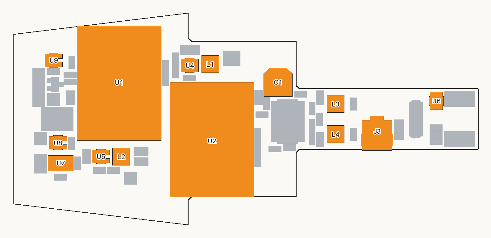
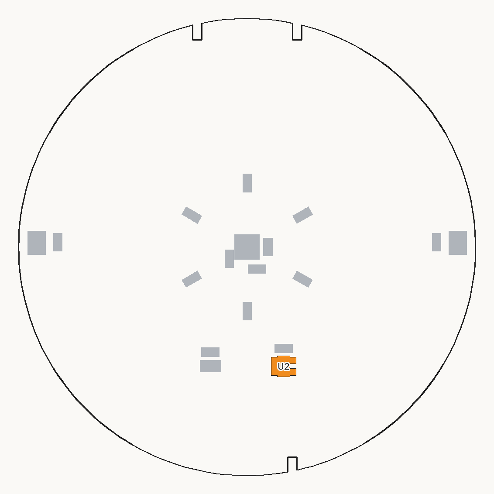
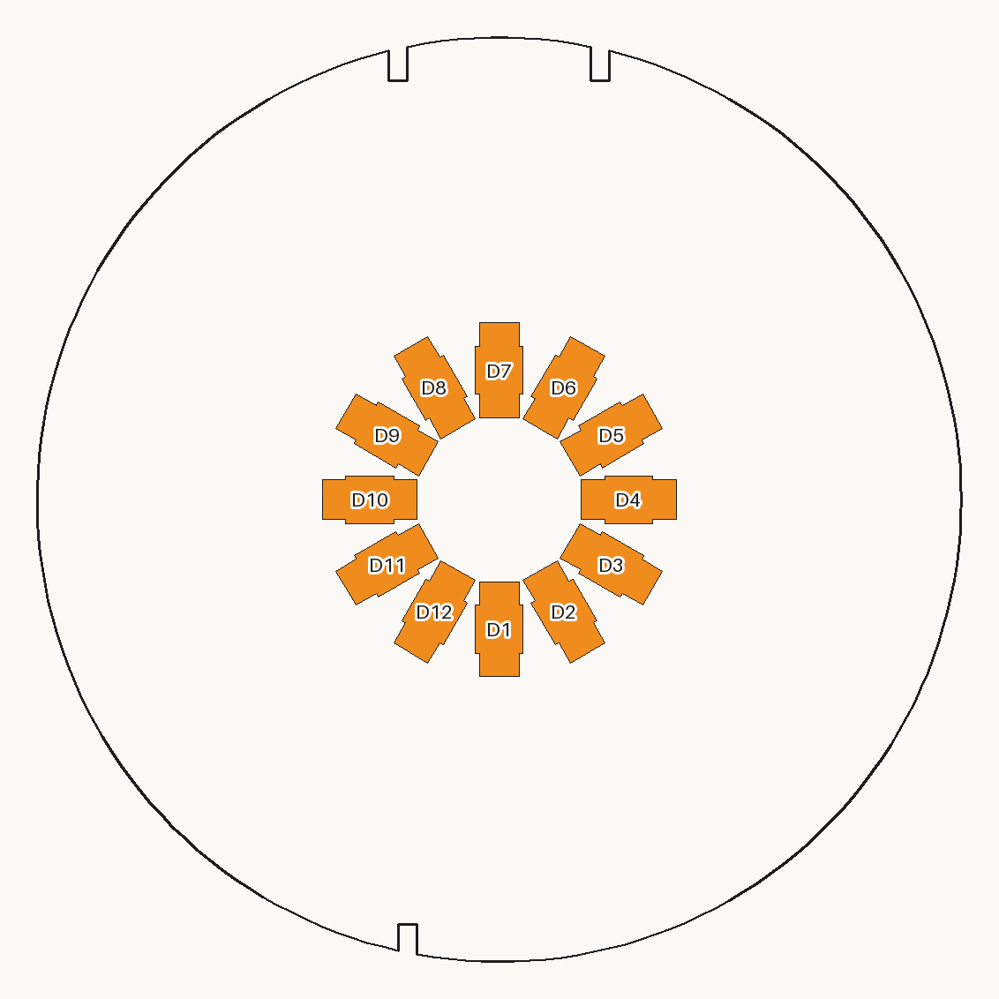

# Manuel de soudure

Ce manuel couvre tout ce qui reste à souder à la main une fois les cartes reçues de JLCPCB. Les pièces délicates
(micros, contrôleur tactile, ampli, USB-C, petits passifs) sont déjà soudées en usine. Il ne reste que des pièces dont
les pattes sont visibles et accessibles à la panne du fer : **pas besoin d'air chaud ni de plaque chauffante**.

[Retour au README](../README.md)

## Sommaire

1. [Liste des composants, face par face](#1-liste-des-composants-face-par-face)
2. [Matériel](#2-matériel)
3. [Où souder : plans](#3-où-souder--plans)
4. [Comment souder, pièce par pièce](#4-comment-souder-pièce-par-pièce)
5. [Liaison entre les cartes : 10 fils](#5-liaison-entre-les-cartes--10-fils)
6. [Contrôles avant la première mise sous tension](#6-contrôles-avant-la-première-mise-sous-tension)

Ordre conseillé : carte mère face composants (petits circuits, puis bobines, condensateur, modules, connecteur),
carte mère face arrière (jack), carte du dessus (tampon, puis LED), fils de liaison, contrôles.

## 1. Liste des composants, face par face

Toutes les pièces s'achètent chez LCSC : le lien ouvre la page de la pièce, avec photos, dimensions et documentation.
Le fichier `hardware/<carte>/fab/gh_<carte>_hand_bom.csv` contient la même liste, prête pour l'outil « BOM Tool » de
LCSC. Les quantités sont pour 1 appareil.

### Carte mère, face composants (14 pièces)

| Repère | Pièce | Lien LCSC | Qté | Boîtier | Variantes acceptées et pièges |
|---|---|---|---:|---|---|
| U1 | ESP32-S3-WROOM-1-N16R8 | [C2913202](https://www.lcsc.com/product-detail/C2913202.html) | 1 | module 18 x 25,5 mm, pattes crénelées | N8R8 ou N16R2 conviennent (PSRAM obligatoire). Pas de WROOM-1U (antenne externe), WROOM-2 ni MINI (brochage différent). |
| U2 | ESP32-WROOM-32E-N4 | [C701341](https://www.lcsc.com/product-detail/C701341.html) | 1 | module 18 x 25,5 mm | N8 / N16 conviennent. Pas de WROOM-32UE (antenne externe) ni de WROVER. |
| U4 | TPS54302DDCR | [C311983](https://www.lcsc.com/product-detail/C311983.html) | 1 | SOT-23-6 (« DDC ») | Régulateur 5 V. Pas de TPS54202 (autre brochage). |
| U5 | TLV62569DBVR | [C141836](https://www.lcsc.com/product-detail/C141836.html) | 1 | SOT-23-5 (« DBV ») | Régulateur 3,3 V. Pas la version DRL (SOT-563, plus petite). |
| U6 | USBLC6-2SC6 | [C7519](https://www.lcsc.com/product-detail/C7519.html) | 1 | SOT-23-6 | Protection USB. |
| U7 | 74LVC1G74DP | [C548409](https://www.lcsc.com/product-detail/C548409.html) | 1 | TSSOP-8 3 x 3 mm (« DP ») | Bascule du mute. Pas les suffixes DC ou GT (boîtiers plus petits). |
| U8 | SN74LVC1G14DBVR | [C7835](https://www.lcsc.com/product-detail/C7835.html) | 1 | SOT-23-5 (« DBV ») | Pas la version DCK (SC-70, plus petite). |
| U9 | SN74LVC1G125DBVR | [C23654](https://www.lcsc.com/product-detail/C23654.html) | 1 | SOT-23-5 (« DBV ») | Pas la version DCK. |
| L1 | 10 uH | [C602032](https://www.lcsc.com/product-detail/C602032.html) | 1 | bobine blindée 4 x 4 x 2 mm (FHD4020S) | Toute bobine blindée 4 x 4 mm de même valeur et de courant au moins égal. |
| L2 | 2,2 uH | [C602029](https://www.lcsc.com/product-detail/C602029.html) | 1 | bobine blindée 4 x 4 x 2 mm | idem |
| L3, L4 | 4,7 uH | [C602031](https://www.lcsc.com/product-detail/C602031.html) | 2 | bobine blindée 4 x 4 x 2 mm | idem (filtre de sortie de l'ampli) |
| C1 | 220 uF / 25 V | [C696188](https://www.lcsc.com/product-detail/C696188.html) | 1 | électrolytique CMS 6,3 x 6,6 mm | **Polarisé.** 25 V minimum, diamètre 6,3 mm. |
| J3 | JST ZH 2 broches, CMS horizontal | [C265329](https://www.lcsc.com/product-detail/C265329.html) | 1 | S2B-ZR-SM4A-TF | Connecteur du haut-parleur, pas de 1,5 mm. |

### Carte mère, face arrière (1 pièce)

| Repère | Pièce | Source | Qté | Remarque |
|---|---|---|---:|---|
| J2 | jack d'alimentation d'origine | carte Google d'origine | 1 | Ne se commande pas : on dessoude celui de l'ancienne carte. L'empreinte reproduit l'originale. |

### Carte du dessus, face composants (1 pièce)

| Repère | Pièce | Lien LCSC | Qté | Boîtier | Variantes acceptées et pièges |
|---|---|---|---:|---|---|
| U2 | SN74AHCT1G125DBVR | [C7484](https://www.lcsc.com/product-detail/C7484.html) | 1 | SOT-23-5 (« DBV ») | **AHCT obligatoire** (entrée 3,3 V, sortie 5 V vers les LED) : pas de version AHC ni LVC. |

### Carte du dessus, face arrière (12 pièces)

| Repère | Pièce | Lien LCSC | Qté | Boîtier | Variantes acceptées et pièges |
|---|---|---|---:|---|---|
| D1 à D12 | WS2812B-MINI-V3J | [C22371519](https://www.lcsc.com/product-detail/C22371519.html) | 12 | 3,5 x 3,5 mm, 4 pattes en J | **Uniquement cette version.** Les WS2812B-2020 ou 1515 ont leurs contacts sous le boîtier (impossible au fer), la WS2812B 5050 est trop grande. Prévoir 2 ou 3 LED de rechange. |

### Liaison entre les cartes

| Pièce | Où l'acheter | Qté | Remarque |
|---|---|---:|---|
| Câbles Dupont femelle-femelle 20 cm | n'importe quel vendeur (paquets de 40) | 10 | On coupe les connecteurs, seul le fil sert. |

## 2. Matériel

- Fer à souder réglable avec panne biseautée de 1 à 2 mm, réglé vers 330 °C (350 °C pour les grosses masses : jack,
  pattes de masse des modules).
- Étain fin 0,5 mm avec flux intégré, plus du flux en seringue (« no clean »).
- Tresse à dessouder (pour retirer un pont d'étain entre deux pattes).
- Pince brucelles fine, loupe ou lampe-loupe.
- Multimètre (contrôles de la section 6).
- Alcool isopropylique et une brosse pour nettoyer le flux.

## 3. Où souder : plans

En orange : à souder soi-même, avec le repère de la pièce. En gris : déjà soudé par JLCPCB.

### Carte mère, face composants

### Carte mère, face arrière

Seul le jack J2, au bout de la partie étroite de la carte, à l'emplacement exact de l'original.

### Carte du dessus, face composants

### Carte du dessus, face arrière (vue carte retournée)

Pour voir une pièce de plus près, ouvrir `hardware/<carte>/gh_<carte>.kicad_pcb` dans KiCad 10 (gratuit) : un clic
sur une pièce affiche son repère et l'orientation de sa broche 1.

## 4. Comment souder, pièce par pièce

### Méthode générale (« une patte d'abord »)

1. Mettre un peu d'étain sur **une seule** pastille de la pièce.
2. Poser la pièce à la brucelle, bien centrée, dans le bon sens (broche 1, voir ci-dessous).
3. Refondre cette pastille : la pièce est tenue par une patte. Corriger l'alignement en refondant si besoin.
4. Souder la patte opposée, puis toutes les autres : panne contre la patte et la pastille, étain apporté au contact,
   1 à 2 secondes par patte.
5. Vérifier à la loupe : chaque soudure est brillante, en congé, sans pont avec la voisine. Un pont se retire avec de la
   tresse et du flux.

### Petits circuits SOT-23-5, SOT-23-6, TSSOP-8 (U4 à U9, U2 du dessus)

- **Broche 1** : petit point ou chanfrein sur le boîtier. Sur la carte, la sérigraphie porte un repère à côté de la
  pastille 1. Vérifier sur la page LCSC de la pièce si le marquage est peu lisible.
- Méthode générale ; pour le TSSOP-8 (pas de 0,65 mm), mettre du flux sur toute la rangée, charger légèrement la panne
  et la glisser le long des pattes : le flux sépare l'étain entre les pattes.

### Bobines 4 x 4 mm (L1 à L4)

- Pas de sens. Les deux contacts sont aux extrémités, sous le boîtier, et les pastilles dépassent de chaque côté.
- Étamer les deux pastilles, poser la bobine, puis chauffer chaque pastille par la partie qui dépasse, en ajoutant
  un peu d'étain et de flux jusqu'à ce que l'étain remonte le long de l'extrémité de la bobine.

### Condensateur électrolytique C1

- **Polarisé** : la bande noire sur le dessus du condensateur marque le **moins**. Sur le socle en plastique, les deux
  coins coupés sont du côté **plus**. Le contour de sérigraphie a lui aussi deux coins coupés : les mettre du même
  côté que ceux du socle.
- Monté à l'envers, il chauffe et peut gonfler : vérifier deux fois avant de souder.

### Modules ESP32 (U1, U2)

- Sens : l'antenne (bout du module sans pattes, avec le tracé en zigzag) va du côté où l'empreinte n'a pas de
  pastilles ; le module ne s'aligne sur les trois rangées de pastilles que dans ce sens.
- Aligner les pattes crénelées sur les pastilles des trois côtés, fixer un angle, contrôler l'alignement des trois
  rangées, fixer l'angle opposé, puis souder toutes les pattes en appuyant la panne sur la pastille qui dépasse.
- La grande pastille de masse sous le module n'a pas besoin d'être soudée.

### Connecteur du haut-parleur J3

- Commencer par les deux grandes pattes de fixation latérales (plus d'étain, chauffer plus longtemps), puis les deux
  broches de signal.

### Jack d'alimentation J2 (face arrière de la carte mère)

1. Sur l'ancienne carte Google, mettre du flux et beaucoup d'étain neuf sur toutes les pattes du jack, puis les
   chauffer à tour de rôle en soulevant doucement le jack (ou utiliser de la tresse pour vider chaque patte).
2. Nettoyer les pattes, vérifier qu'elles sont droites.
3. Engager les 2 ergots du jack dans les 2 trous de la nouvelle carte : la position est alors exacte.
4. Souder les pattes avec un fer à 350 °C (grosse masse de cuivre).

### LED WS2812B-MINI-V3J (D1 à D12, face arrière de la carte du dessus)

- **Sens** : la broche 1 (VDD, +5 V) est repérée sur le boîtier ; le dessin coté de la documentation (page LCSC)
  montre ce repère. Sur le plan, les LED sont disposées en
  étoile, leurs pattes alignées vers le centre : toutes les LED ont la même orientation par rapport au centre. Ouvrir
  `hardware/topboard/gh_topboard.kicad_pcb` dans KiCad pour voir la pastille 1 de D1, puis souder les 12 dans le même
  sens. Une LED montée à l'envers ne s'allume pas et coupe la suite de la chaîne.
- Les LED craignent la chaleur : 2 à 3 secondes maximum par patte, attendre quelques secondes avant la patte suivante.
- Méthode générale : une patte, alignement, puis les trois autres. Les pattes en J sont visibles sur les côtés : la
  soudure doit remonter sur la patte.
- Ordre : D1 (à 6 h, côté des pastilles de fils) puis D2, D3, etc. Après chaque groupe de 3 LED, on peut tester
  l'anneau (section 6) : la chaîne s'arrête à la première LED mal soudée, ce qui la désigne.

## 5. Liaison entre les cartes : 10 fils

Pastilles J4 (carte mère) et J1 (carte du dessus), au pas de 2,54 mm, numérotées dans le même ordre :

| Broche | Signal | Broche | Signal |
|---|---|---|---|
| 1 | +5 V | 6 | SCL |
| 2 | GND | 7 | VMIC |
| 3 | données LED | 8 | DAT (micros) |
| 4 | +3,3 V | 9 | GND |
| 5 | SDA | 10 | CLK (micros) |

1. Prendre une nappe de 10 câbles Dupont (ils restent collés côte à côte).
2. Couper les connecteurs aux deux bouts. Longueur finale : **12 à 15 cm**, assez pour ouvrir l'appareil sans tirer.
3. Dénuder 2 mm, torsader les brins, étamer.
4. Étamer les pastilles, poser chaque fil à plat sur sa pastille et chauffer jusqu'à ce que les deux étains se
   mélangent. Même ordre des deux côtés : fil 1 sur pastille 1 à chaque bout.
5. **Torsader ensemble les fils 9 (GND) et 10 (CLK)** sur toute la longueur : cela protège l'horloge des micros.
6. Une goutte de colle chaude près des pastilles, côté isolant, soulage les soudures.

Variante démontable : souder une barrette de 10 broches mâles CMS au pas de 2,54 mm sur J4 de la carte mère et garder
les connecteurs Dupont de ce côté.

## 6. Contrôles avant la première mise sous tension

1. **Courts-circuits** (multimètre en mode continuité, carte non alimentée) : aucun bip entre +5 V et GND, ni entre
   +3,3 V et GND. Pastilles de test de la carte mère : TP5 = GND, TP6 = 3V3, TP7 = 5V.
2. **Inspection** à la loupe de chaque pièce soudée à la main : ponts, pattes en l'air, sens de C1 et des circuits.
3. **Première mise sous tension par l'USB-C**, jack débranché : environ 4,7 V sur TP7 (l'USB passe par une diode)
   et 3,3 V sur TP6. Si une tension manque ou si une pièce chauffe, débrancher et revoir U4, U5, L1, L2.
4. **Flasher le firmware** (voir le [README](../README.md#firmware)), puis brancher l'alimentation d'origine sur le
   jack : TP7 doit afficher environ 5,1 V.
5. **Test des LED** : dans Home Assistant, allumer l'entité « Anneau » et choisir l'effet « Arc-en-ciel ». Si la chaîne
   s'arrête à la LED n, revoir la soudure de la LED n et de la n-1.
6. **Test tactile** : rotation sur l'anneau = volume, appui bref au centre ou sur l'anneau = pause / lecture.
